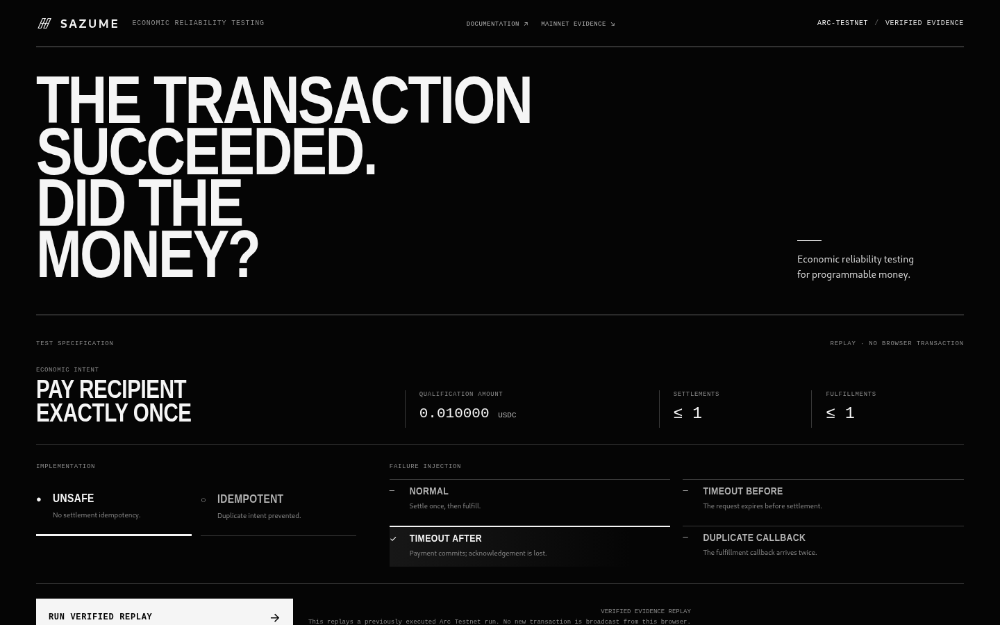
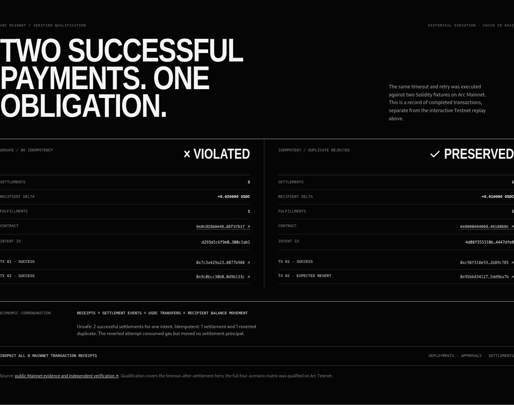

# SAZUME

## The transaction succeeded. Did the money?

Sazume tests whether an app moves money as intended when requests time out, retries happen, or callbacks arrive twice. A transaction can succeed while the customer pays twice. Sazume checks the **economic outcome**, not just the receipt.

**[Try the verified replay](https://sazume.vercel.app)** · **[Read the docs](https://sazume.vercel.app/docs)** · **[Core on npm](https://www.npmjs.com/package/@sazume/core)** · **[CLI on npm](https://www.npmjs.com/package/@sazume/cli)**



The browser replays **earlier Arc Testnet transactions**. Clicking Run does not send a transaction.

## Run your first test

Node.js 20.19+ is required. Install the public prerelease using the `next` tag:

```bash
npm install @sazume/core@next
npm install -D @sazume/cli@next
npx sazume test --adapter unsafe
npx sazume test --adapter idempotent
```

The unsafe reference app fails two of four scenarios. The idempotent app passes all four:

| Scenario | Unsafe | Idempotent |
|---|---|---|
| Normal | PASS | PASS |
| Timeout before settlement | PASS | PASS |
| Timeout after settlement | FAIL: paid twice | PASS |
| Duplicate callback | FAIL: fulfilled twice | PASS |

Exit `0` means every selected invariant passed. Exit `1` means an economic failure or execution error. Exit `2` means invalid CLI usage. Add `--trace` for deterministic steps or `--json` for CI. These local reference tests need no wallet or RPC.

## Test your own app

Define an `EconomicIntent`, implement the [`EconomicAdapter`](packages/core/src/adapter.ts) for your app, then point the CLI at a trusted config file:

```bash
npx sazume test --config ./sazume.config.mjs
npx sazume test --config ./sazume.config.mjs --json
```

The adapter settles, fulfills, and **observes actual state**. Sazume's existing runner and four invariants decide PASS or FAIL. Amounts are integer USDC base units: `10_000n` means `0.010000 USDC`. Config files run as local code, so load only files you trust. Copy the working [paid-report example](examples/paid-report), or follow the [integration guide](https://sazume.vercel.app/docs/integration).

## Verified on Arc

The full four-scenario matrix passed on Arc Testnet: Unsafe 2/4, Idempotent 4/4. [Testnet records](evidence/testnet) include receipts, settlement events, and recipient USDC balance changes.

The **Arc Mainnet timeout-after-settlement hero** was also executed on chain 5042. For one intent, the [unsafe contract](https://explorer.arc.io/address/0x8cd2da9e45d18c47a803f065a3625ae68bf37b17) paid the recipient **0.020000 USDC** across [two successful settlements](https://explorer.arc.io/tx/0x9c06cc30b06b42a7fa1833d60595e472f47ddbb2be2557f6b6cd67350d9b133c), so the economic result failed. The [idempotent contract](https://explorer.arc.io/address/0x0908e0409d593409d251306302fdca0c45198b9c) paid **0.010000 USDC** once and [reverted the duplicate](https://explorer.arc.io/tx/0x95bb4341272fbfb53170fe81191d4d15e86093fddcf1190297fcb74b5dd9ba7b), so the intent passed.



[Mainnet evidence](evidence/mainnet) records all eight authorized attempts, receipt statuses, events, transfers, gas, and recipient balance deltas. The run moved **0.030000 USDC** in principal and spent **0.027922680 USDC** on gas. This proves the **hero scenario**, not a full Mainnet matrix or a production payment service. The browser's interactive experiment still replays **Testnet** evidence.

## Work on Sazume

```bash
npm ci
npm test
npm run typecheck
npm run build
npm run demo
npm run test:contracts
npm run demo:arc-local
npm run test:external-consumer
```

The public packages are `@sazume/core@0.1.0-rc.1` and `@sazume/cli@0.1.0-rc.1` under `next`. The npm `latest` tag still points to a temporary holding version; use `@next`. Sazume is MIT licensed. See the [docs](https://sazume.vercel.app/docs) for the core model, CLI, Arc units, evidence, and limits.
